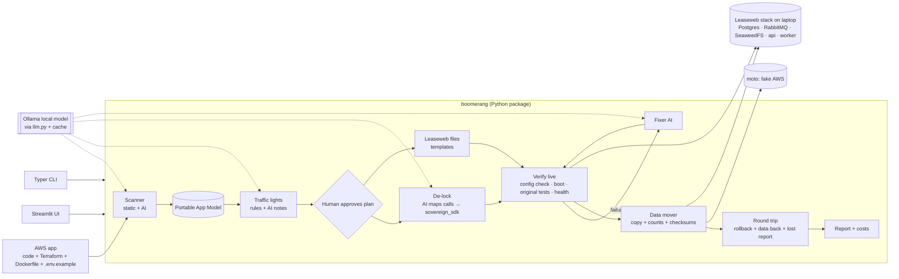

# 02 · Architecture (v2)

## 1. System overview



## 2. Key decisions

| # | Decision | Why |
|---|---|---|
| D1 | One Python package used by CLI and UI directly | No API layer to build |
| D2 | Platform-neutral **PAM** in the middle | Scanner, classifier, generators and reports share one model |
| D3 | **Adapters, not AI-invented SQL/AMQP.** `sovereign_sdk.kv` and `.queue` mimic boto3 signatures and are tested by us | Small models stay reliable; semantics are handled in code we can test |
| D4 | AI works **per function**, not per file (Python `ast` slicing + stitching) | Small prompts → fast and accurate on a 7B model |
| D5 | Templates for all infrastructure files | Must be exactly right |
| D6 | Original tests are the spec; AI can never touch `tests/` | Credible proof |
| D7 | **AWS untouched until checks pass**; the original code is kept as-is | Safe rollback = redeploy original + copy data back |
| D8 | Moto for AWS; the **generated** Leaseweb compose itself is booted for verification | We verify the real deliverable, not a stand-in |
| D9 | Local LLM (Ollama), single model, `keep_alive=60m`; Claude fallback by env | Sovereignty story; no model-swap freezes |
| D10 | Every LLM schema puts a reasoning field **first** | Small models decide better after writing a diagnosis |
| D11 | Rules check after every LLM output (paths, compile, forbidden calls) | Valid JSON ≠ correct action |
| D12 | Events for every stage → `events.jsonl` | Live UI + offline replay |

## 3. The contract: `boomerang/models.py`

Tech lead writes this in the first 30 minutes. LLM-facing models use only flat objects and lists (no dicts/unions), with the reasoning field first.

```python
from __future__ import annotations
from typing import Literal, Any
from pydantic import BaseModel

Platform = Literal["aws", "leaseweb"]
Light = Literal["green", "amber", "red"]
Kind = Literal["object_store", "kv_table", "queue", "function", "trigger", "identity", "monitoring", "other"]
Provider = Literal[
    "aws.s3", "aws.dynamodb", "aws.sqs", "aws.lambda", "aws.iam", "aws.cloudwatch", "aws.other",
    "lw.object_storage",   # SeaweedFS on the server, or Leaseweb Object Storage
    "lw.postgres", "lw.rabbitmq", "none",
]

# ---------- PAM (scanner output, LLM-facing) ----------
class EnvVar(BaseModel):
    name: str; value: str; purpose: str

class KeyAttr(BaseModel):
    name: str; type: Literal["S", "N"] = "S"

class Index(BaseModel):
    name: str; partition_key: KeyAttr; sort_key: KeyAttr | None = None

class CodeRef(BaseModel):
    file: str                    # "app/db.py" or "infra/main.tf"
    line: int
    symbol: str | None = None    # enclosing function, e.g. "get_order"
    operation: str               # "put_item", "send_message", "aws_lambda_permission"...
    snippet: str

class Component(BaseModel):
    id: str                      # "orders", "receipts", "order_events", "receipt_thumbnailer"
    kind: Kind
    provider: Provider
    resource_name: str
    name_env_var: str | None = None
    partition_key: KeyAttr | None = None      # kv_table
    sort_key: KeyAttr | None = None
    indexes: list[Index] = []
    fifo: bool = False                        # queue
    max_receive_count: int | None = None      # queue DLQ redrive
    visibility_timeout_s: int | None = None
    features: list[str] = []     # used features: "conditional_write", "gsi", "dlq", "event_notification", "ttl", ...
    usages: list[CodeRef] = []

class FileInfo(BaseModel):
    path: str
    role: Literal["app", "infra", "test", "config", "other"]
    component_ids: list[str] = []

class AppModel(BaseModel):       # PAM
    pam_version: Literal["0.2"] = "0.2"
    app_name: str
    platform: Platform
    entrypoints: list[str]
    test_command: str = "pytest -q tests"
    components: list[Component]
    files: list[FileInfo]
    env: list[EnvVar]

# ---------- Traffic lights ----------
class Finding(BaseModel):
    analysis: str                # reasoning first
    component_id: str
    feature: str                 # "basic object ops", "conditional_write", "dlq", "event_notification"...
    light: Light
    what_changes: str            # one sentence, user-facing
    evidence: list[CodeRef] = []

class Assessment(BaseModel):
    findings: list[Finding]
    overall: Light               # worst light that is migrated; reds are listed separately
    summary: str

# ---------- De-lock (LLM-facing, per function) ----------
class FunctionRewrite(BaseModel):
    analysis: str                # what the function does and which calls must change
    new_source: str              # the complete function (def ... ) only
    unsupported: list[str] = []  # features the adapter can't do → become red/amber findings

class FixResult(BaseModel):
    root_cause_analysis: str
    file: str
    function: str
    new_source: str

# ---------- Verification ----------
class Check(BaseModel):
    name: str                    # "compose config", "boot", "tests", "health", "schema"
    ok: bool
    detail: str = ""
    duration_s: float = 0

class TestFailure(BaseModel):
    test: str; message: str; traceback: str

class TestReport(BaseModel):
    attempt: int; platform: Platform
    passed: int; failed: int; errors: int; total: int; duration_s: float
    failures: list[TestFailure] = []
    output_tail: str = ""
    @property
    def ok(self) -> bool: return self.total > 0 and self.failed == 0 and self.errors == 0

class Verification(BaseModel):
    checks: list[Check]
    tests: TestReport | None = None
    @property
    def ok(self) -> bool: return all(c.ok for c in self.checks) and bool(self.tests and self.tests.ok)

# ---------- Data ----------
class DataCount(BaseModel):
    component_id: str
    kind: Kind
    source_count: int
    target_count: int
    checksum_match: bool | None = None
    notes: list[str] = []

class DataMove(BaseModel):
    direction: Literal["aws->leaseweb", "leaseweb->aws"]
    counts: list[DataCount]
    @property
    def ok(self) -> bool: return all(c.source_count == c.target_count and c.checksum_match is not False for c in self.counts)

class LostItem(BaseModel):
    component_id: str
    feature: str
    status: Literal["preserved", "changed", "lost"]
    detail: str

# ---------- Events & runs ----------
Stage = Literal["scan", "assess", "approve", "delock", "generate", "verify", "fix", "data", "rollback", "report", "cost"]

class Event(BaseModel):
    ts: float; run_id: str; stage: Stage
    level: Literal["info", "success", "warning", "error"] = "info"
    message: str
    data: dict[str, Any] | None = None

class RunSummary(BaseModel):
    run_id: str; source_dir: str
    status: Literal["running", "awaiting_approval", "passed", "failed", "error"]
    started_at: float; finished_at: float | None = None
    lock_in_before: int | None = None; lock_in_after: int | None = None
    assessment: Assessment | None = None
    verifications: list[Verification] = []
    data_moves: list[DataMove] = []
    lost: list[LostItem] = []
    out_dir: str
```

## 4. Traffic-light rules (owner B, `boomerang/assess.py`)

Rules decide the light; the AI only writes `analysis` and `what_changes` and may **raise** a light, never lower it.

| Component / feature | Light | Why |
|---|---|---|
| S3 basic ops (put/get/list/delete/head) | 🟢 | S3-compatible API; endpoint + keys change only |
| S3 presigned URLs, versioning, lifecycle rules | 🟠 | Supported differently or needs config on the target |
| S3 event notifications → Lambda/SQS | 🔴 | No equivalent wired up; needs a human |
| DynamoDB put/get/update/delete, query on key or GSI | 🟠 | Postgres via `kv` adapter; GSIs become indexes |
| DynamoDB `ConditionExpression` (`attribute_not_exists` / `attribute_exists`) | 🟠 | Adapter supports these two only |
| DynamoDB other conditions, transactions, streams, TTL, PartiQL | 🔴 | Not supported by the adapter |
| SQS standard: send/receive/delete, visibility timeout, DLQ (maxReceiveCount) | 🟠 | RabbitMQ quorum queue + DLX via `queue` adapter |
| SQS FIFO, message attributes filtering, delay queues | 🔴 | Not supported by the adapter |
| IAM roles / instance profiles / policies | 🔴 | Replaced by generated, scoped service credentials; review needed |
| Lambda functions, CloudWatch alarms, other AWS resources | 🔴 | Flagged, not migrated |

## 5. `sovereign_sdk`: the adapters (shipped into the migrated app)

Deterministic, unit-tested by us, copied into the migrated app by the generator. They **mimic boto3 call signatures and return shapes**, so the AI's job is mapping, not inventing.

```python
# sovereign_sdk/kv.py  (Postgres)
def resource() -> "KV"                         # reads DATABASE_URL
class KV:   def Table(self, name: str) -> "Table"
class Table:
    def put_item(self, Item: dict, ConditionExpression=None) -> dict
    def get_item(self, Key: dict) -> dict      # {"Item": {...}} or {}
    def update_item(self, Key, UpdateExpression, ExpressionAttributeNames=None,
                    ExpressionAttributeValues=None, ConditionExpression=None) -> dict   # "SET a = :v, #b = :w" only
    def delete_item(self, Key: dict) -> dict
    def query(self, KeyConditionExpression, IndexName=None) -> dict   # {"Items": [...]}; Key(x).eq(v) only
    def scan(self) -> dict                      # {"Items": [...]} (used by the data mover)
# Numbers are returned as Decimal, like boto3. Unsupported expressions raise UnsupportedFeature.
# Errors raise botocore-like ConditionalCheckFailedException with .response["Error"]["Code"].

# sovereign_sdk/queue.py  (RabbitMQ via pika)
def client() -> "Queue"                        # reads AMQP_URL
class Queue:
    def get_queue_url(self, QueueName: str) -> dict
    def send_message(self, QueueUrl: str, MessageBody: str) -> dict          # {"MessageId": ...}
    def receive_message(self, QueueUrl, MaxNumberOfMessages=1, WaitTimeSeconds=0,
                        VisibilityTimeout=None) -> dict                      # {"Messages": [{"MessageId","ReceiptHandle","Body"}]}
    def delete_message(self, QueueUrl, ReceiptHandle) -> dict                # basic_ack
# Semantics: quorum queue with x-delivery-limit = maxReceiveCount and a dead-letter exchange → "<name>-dlq".
# Unacked messages older than VisibilityTimeout are nacked (requeue=True) on the next call → redelivered.

# sovereign_sdk/storage.py
def s3_client()                                # boto3 S3 client from S3_ENDPOINT_URL / S3_ACCESS_KEY_ID / S3_SECRET_ACCESS_KEY, path-style
```

Postgres schema per kv table (single source: `sovereign_sdk.kv.ddl(component)`, used by the generator):
`<pk> TEXT|NUMERIC NOT NULL, [<sk>], <one column per index key>, data JSONB NOT NULL, PRIMARY KEY(<pk>[,<sk>])` + `CREATE INDEX` per GSI. `data` holds the whole item.

## 6. Env contract

| Var | aws (lab: moto) | leaseweb |
|---|---|---|
| `AWS_REGION` / `AWS_ACCESS_KEY_ID` / `AWS_SECRET_ACCESS_KEY` | `us-east-1` / `test` / `test` | – |
| `AWS_ENDPOINT_URL` | `http://127.0.0.1:4566` | – |
| `DATABASE_URL` | – | `postgresql://shoplite:<generated>@postgres:5432/shoplite` (laptop: `127.0.0.1`) |
| `AMQP_URL` | – | `amqp://shoplite:<generated>@rabbitmq:5672/shoplite` |
| `S3_ENDPOINT_URL` / `S3_ACCESS_KEY_ID` / `S3_SECRET_ACCESS_KEY` | – | SeaweedFS `http://seaweedfs:8333` or Leaseweb Object Storage endpoint |
| `ORDERS_TABLE` / `RECEIPTS_BUCKET` / `ORDER_EVENTS_QUEUE` | names | same names |

Always `127.0.0.1` on the laptop (not `localhost`): avoids slow IPv6 lookups on Windows and forces path-style S3.

## 7. Pipeline

```mermaid
sequenceDiagram
    participant U as User
    participant P as pipeline
    U->>P: migrate(sample-app/aws)
    P->>P: scan → PAM → assess (lights) → lock-in
    P-->>U: plan + traffic lights
    U->>P: approve
    P->>P: copy app → out/app; de-lock functions (AI) ; generate Leaseweb files
    loop max 2 attempts
      P->>P: verify: compose config → boot → tests → health
      alt failures
        P->>P: fixer (AI, per function, never tests/)
      end
    end
    P->>P: data: AWS (moto) → Leaseweb (counts + checksums)
    U->>P: roundtrip
    P->>P: create a new order on Leaseweb; copy data back → AWS; run original code's tests on AWS; counts; lost report
    P-->>U: report + costs
```

## 8. Run artifacts

```
runs/<run_id>/
  run.json  events.jsonl  pam.json  assessment.json
  original/                 # untouched copy of the AWS app (rollback source)
  leaseweb/                 # THE DELIVERABLE
    app/                    # de-locked app + sovereign_sdk/ + tests/ (copied unchanged)
    docker-compose.yml  .env.example  cloud-init.yaml  deploy.sh  backup/pg_backup.sh
    rabbitmq/definitions.json  seaweedfs/s3.json  schema.sql  DEPLOY.md
    secrets.env             # generated passwords; git-ignored; never sent to the LLM
  diffs/<file>__<function>.diff
  verify/attempt-<n>.json
  data/aws-to-leaseweb.json  data/leaseweb-to-aws.json
  lost.json  report.md  cost.json
```

## 9. Repository layout

```
boomerang/
  models.py config.py events.py cli.py llm.py redact.py      # C (redact: see 13)
  lab.py                                                       # A
  scanner/static.py scanner/ai.py scanner/__init__.py          # B
  assess.py lockin.py                                          # B
  slicer.py delock.py fixer.py rules.py pipeline.py report.py  # C
  generators/leaseweb.py generators/templates/*.j2             # B
  verifier.py provisioner_aws.py datamover.py                  # A
  lost.py                                                      # B
  cost.py                                                      # D
sovereign_sdk/ kv.py queue.py storage.py                       # kv: B, queue: A, storage: C
tests/sovereign_sdk/                                           # adapter tests (owners)
pricing/prices.yaml pricing/usage.default.yaml                 # D (data collected before the event)
prompts/ scan.md assess.md delock.md fix.md
ui/app.py ui/components/*.py                                   # D
sample-app/aws/ sample-app/tests/                              # A
infra/lab.compose.yml                                          # A (moto only)
fixtures/                                                      # B + D
runs/golden/  demo/llm-cache/
```
